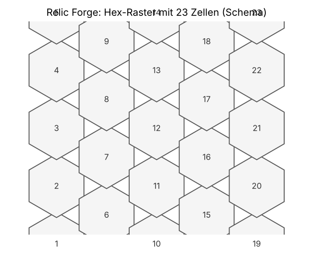
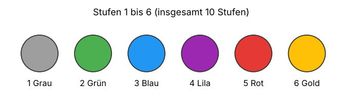
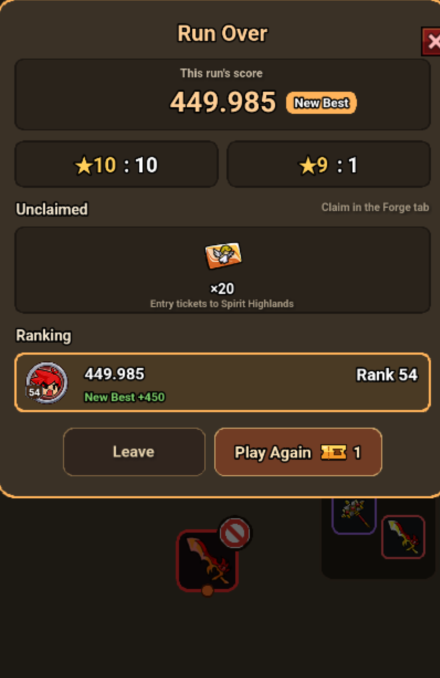

# Relic Forge Assistent – Dokumentation

Dokumentation zu einem **AutoIt-Overlay**, das beim Relic-Forge-Minispiel von Endless Frontier 2 (EF2) die beste Platzierung für das aktuelle Teil anzeigt. Nur Beschreibung, kein Quellcode.

## Was es macht

- Liest per Pixelerkennung das **Spielfeld**, das **aktuelle Teil**, das **Next-Teil** und die **Hammer-Ladungen**
- Berechnet die beste Platzierung samt Drehung und blendet sie als **transparentes, klick-durchlässiges Overlay** über dem Spiel ein
- Das Overlay **spielt nicht selbst**. Es zeigt einen Vorschlag, die Züge macht der Mensch.

## Spielmodell

- Hex-Raster mit **23 Zellen** in fünf Spalten (5, 4, 5, 4, 5)
- Teile bestehen aus mehreren Relikten und lassen sich in 60°-Schritten drehen
- Ab **3 gleichen Relikten** verschmilzt ein Merge, ab **5** geht es zwei Stufen hoch und gibt eine Hammer-Ladung
- Niedrige Stufen verschmelzen zuerst, das Ergebnis landet auf dem Punkt-Relikt, Ketten laufen von dort weiter
- Stufen 1 bis 6 sind Grau, Grün, Blau, Lila, Rot, Gold; insgesamt gibt es 10 Stufen
- Spawn-Regel: Stufe X entfernt Stufe X−4 aus dem Pool (einstellbar über `PoolShift` in der INI)
- Nicht mehr spawnende Relikte gelten als „toter Ballast“ und werden bevorzugt per Hammer entfernt

## Bilder

Die ersten beiden Bilder sind Schemazeichnungen, das dritte ist ein Screenshot aus dem Spiel.

## Bedienung (NumLock an)

| Taste | Funktion |
|---|---|
| Numpad 0 | Jetzt analysieren, bestätigt auch die Kalibrierung |
| Numpad 1 | Auto-Modus an/aus |
| Numpad 2 | Overlay an/aus |
| Numpad 3 | Kalibrierung neu starten |
| Numpad 4 | Nächste Alternative (die fünf besten Züge) |
| Numpad 5 | Debug-Anzeige |
| Numpad 6 | Hammer automatisch oder manuell |
| Numpad 7 / 8 | Hammer −1 / +1 (manuell) |
| Numpad 9 | Hilfe |
| Numpad Punkt | Aktuellen Vorschlag als schlecht markieren (Log und Screenshot) |
| Strg+Alt+1 bis 9, 0 | Relikt unter der Maus als Stufe 1 bis 10 lernen |
| Strg+Alt+Q | Beenden |

## Einrichtung

1. AutoIt 3.3.14 oder neuer installieren. Das Spiel muss im Fenster- oder Borderless-Modus laufen.
2. Beim ersten Start fragt eine Kalibrierung sechs Punkte ab: Feld oben links, Feld unten rechts, aktuelles Teil, Next-Feld und die beiden Hammer-Felder.
3. Die Relikt-Erkennungsmuster sind für alle 10 Stufen vorbelegt. Nachlernen ist mit Strg+Alt+Zahl möglich.

## Weitere Funktionen

- **Forge Toolbox:** kleines Fenster mit Schalter für das Overlay
- **Konfiguration:** `RelicForge.ini` mit Abschnitten `Cfg` (Erkennung und Bewertung), `Sig` (gelernte Muster), `Cal` (Kalibrierung), `Adb` (Bildaufnahme über ADB aus einem Emulator)
- **Aufnahmemodus:** `RecordingMode` steuert, ob das Overlay beim Bildschirmvideo kurz blinkt oder ausgeblendet bleibt
- **Hammer- und Stern-Automatik** als Schalter in der INI

## Log-System

Pro Start entsteht `logs\session_JJJJMMTT_HHMMSS.log`. Es enthält:

- **STATE:** erkannte Lage (Brett, Teil, Next, Hammer, Spawn-Pool, unbekannte Kacheln, Rechenzeit)
- **PLAN:** jeder Vorschlag samt vorhergesagtem Brett
- **OUT:** Vergleich von Vorhersage und Wirklichkeit mit Klassen wie `FOLLOWED_SHOWN`, `FOLLOWED_ALTn`, `OTHER_PLACEMENT`, `HAMMER_USED`, `MODEL_MISMATCH`, `NOPLAN`, `BOARD_UNCHANGED`, `NEW_RUN`
- **CHK:** Kontrollen der Next-Erkennung und der Spawn-Regel
- **EVT, UNSTABLE, SUM:** Ereignisse, fehlerhafte Aufnahmen, Zusammenfassung
- **MARK:** manuell als schlecht markierte Vorschläge

`MODEL_MISMATCH` ist der wichtigste Eintrag: Entweder wurde ein Relikt falsch gelesen, oder die Regeln im Modell stimmen nicht.

## Bewertung und Simulator

Die Platzierung wird mit Vorausschau über das Next-Teil bewertet. Ein Simulator lieferte mit der jetzigen Bewertung die Stufe 9 in rund 9 von 10 Spielen und die Stufe 10 in etwa 6 bis 8 %. Vier zusätzliche Bewertungsmerkmale brachten dort keine Verbesserung. Die Berechnung dauert je nach Füllung 1 bis 3 Sekunden.

## Status und Grenzen

- Mehrere Fassungen wurden nicht in AutoIt ausgeführt, sondern nur auf Struktur und Variablen geprüft.
- Die Stufenfarben und die Pool-Regel für Stufe 7 und höher sind aus Screenshots abgeleitet und können abweichen.
- Auf manchen Emulatoren liefert die Bildaufnahme schwarze Bilder. Dafür gibt es die ADB-Aufnahme.
