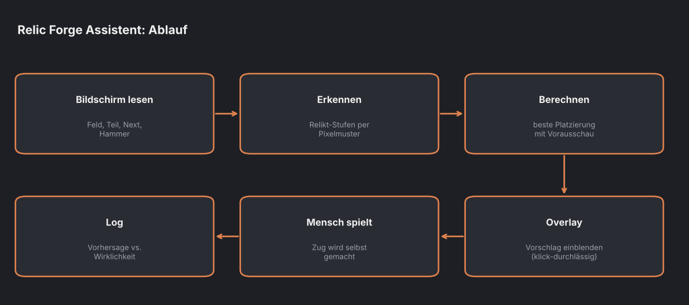

# Relic Forge Assistent – Dokumentation

**AutoIt-Overlay für das Relic-Forge-Minispiel von Endless Frontier 2 (EF2).** Es liest das Spielfeld per Pixelerkennung, berechnet die beste Platzierung für das aktuelle Teil und blendet sie als transparentes, klick-durchlässiges Overlay ein. **Das Overlay spielt nicht selbst:** Es zeigt einen Vorschlag, den Zug macht der Mensch.

> Nur Dokumentation, kein Quellcode.

## Inhalt

| Seite | Thema |
|---|---|
| [docs/spielregeln.md](docs/spielregeln.md) | Das Minispiel und das Modell dahinter |
| [docs/bedienung.md](docs/bedienung.md) | Tasten, Kalibrierung, Einrichtung |
| [docs/erkennung.md](docs/erkennung.md) | Wie das Programm das Bild liest |
| [docs/bewertung.md](docs/bewertung.md) | Bewertung der Züge, Vorausschau, Simulator |
| [docs/konfiguration.md](docs/konfiguration.md) | Die INI-Datei im Überblick |
| [docs/logs.md](docs/logs.md) | Log-System und Auswertung |
| [docs/zusammenspiel-bot.md](docs/zusammenspiel-bot.md) | Zusammenspiel mit dem Idle-Bot |
| [docs/grenzen.md](docs/grenzen.md) | Status, Grenzen, bekannte Probleme |

## Ablauf

## Überblick

- Liest **Spielfeld**, **aktuelles Teil**, **Next-Teil** und **Hammer-Ladungen**
- Berechnet die beste Platzierung samt Drehung, mit Vorausschau über das Next-Teil
- Zeigt bis zu fünf Alternativen (Numpad 4 schaltet weiter)
- Entscheidet, wann ein Hammer sinnvoll ist, und markiert „toten Ballast“
- Schreibt ein ausführliches Log, das Vorhersage und Wirklichkeit vergleicht
- Kleine **Forge Toolbox** mit Schalter für das Overlay
- Bildaufnahme wahlweise vom Fenster oder über ADB aus einem Emulator

## Voraussetzungen

- Windows, AutoIt 3.3.14 oder neuer
- Spiel im Fenster- oder Borderless-Modus (oder Emulator mit ADB-Aufnahme)
- Eine einmalige Kalibrierung (sechs Punkte)
