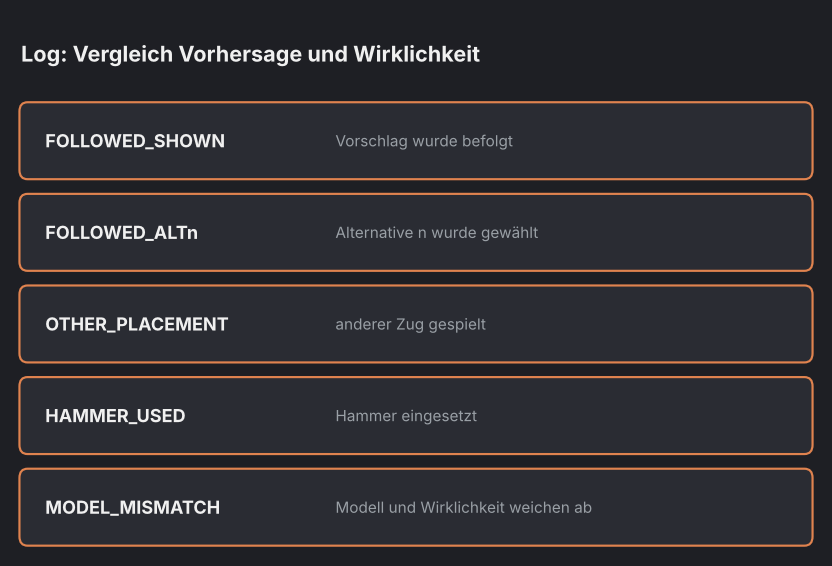

# Log-System

Pro Start entsteht eine Datei `logs\session_JJJJMMTT_HHMMSS.log`. Sie dient dazu, Fehler in Erkennung und Modell zu finden.

## Zeilentypen

| Typ | Inhalt |
|---|---|
| **STATE** | Erkannte Lage: Brett, Teil, Next, Hammer, Spawn-Pool, unbekannte Kacheln, Rechenzeit |
| **PLAN** | Jeder Vorschlag samt vorhergesagtem Brett |
| **OUT** | Vergleich von Vorhersage und Wirklichkeit |
| **CHK** | Kontrollen der Next-Erkennung und der Spawn-Regel |
| **EVT** | Ereignisse |
| **UNSTABLE** | Fehlerhafte Aufnahmen |
| **SUM** | Zusammenfassung |
| **MARK** | Manuell als schlecht markierte Vorschläge |

## OUT-Klassen

| Klasse | Bedeutung |
|---|---|
| `FOLLOWED_SHOWN` | Der angezeigte Vorschlag wurde befolgt |
| `FOLLOWED_ALTn` | Die n-te Alternative wurde gespielt |
| `OTHER_PLACEMENT` | Ein anderer Zug wurde gespielt |
| `HAMMER_USED` | Ein Hammer wurde eingesetzt |
| `MODEL_MISMATCH` | Das Brett weicht von der Vorhersage ab |
| `NOPLAN` | Es gab keinen Plan, zum Beispiel beim Start |
| `BOARD_UNCHANGED` | Das Brett hat sich nicht geändert |
| `NEW_RUN` | Ein neuer Lauf hat begonnen |

`MODEL_MISMATCH` ist der wichtigste Eintrag: Entweder wurde ein Relikt falsch gelesen, oder die Regeln im Modell stimmen nicht.

## Typische Auswertung

1. Nach einer Sitzung im Log nach `MODEL_MISMATCH` suchen.
2. Die zugehörige STATE- und PLAN-Zeile ansehen.
3. Passt ein Relikt nicht, mit Strg+Alt+Zahl nachlernen. Passt die Spawn-Regel nicht, `PoolShift` anpassen.
4. Schlechte Vorschläge im Spiel mit Numpad Punkt markieren: Das Log enthält dann einen MARK-Eintrag mit Screenshot.

## Aufräumen

Logs können groß werden (bis zu einigen Hundert Kilobyte pro Sitzung). Alte Logs lassen sich gefahrlos löschen.
