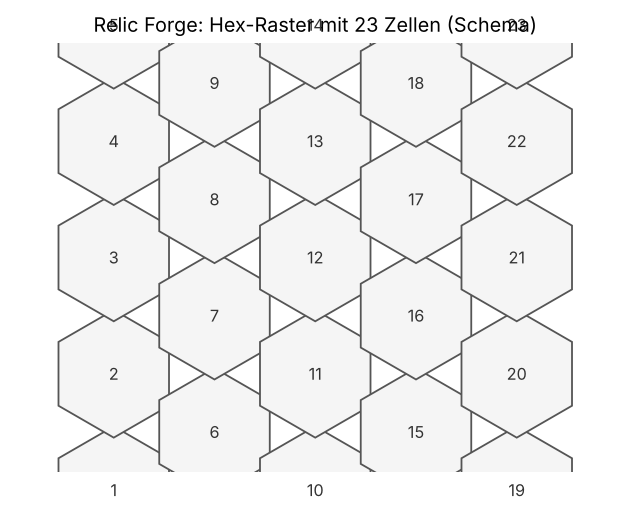
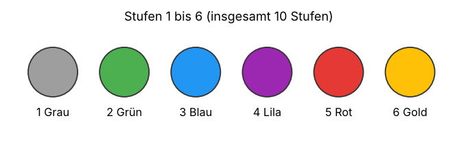

# Spielregeln und Modell

## Das Spielfeld

Das Brett ist ein Hex-Raster mit **23 Zellen** in fünf Spalten (5, 4, 5, 4, 5). Pro Zug wird ein Teil gesetzt. Ein Teil besteht aus mehreren Relikten und lässt sich in 60°-Schritten drehen. Daneben zeigt das Spiel das Teil, das als Nächstes kommt (Next).

## Stufen

Es gibt **10 Stufen**. Die ersten sechs sind Grau, Grün, Blau, Lila, Rot und Gold. Je höher die Stufe, desto mehr Punkte bringt das Relikt.

## Verschmelzen (Merge)

- Ab **3 gleichen Relikten** in einer Gruppe verschmelzen sie zu einem Relikt der nächsthöheren Stufe.
- Ab **5 gleichen** geht es zwei Stufen hoch, und es gibt eine **Hammer-Ladung**.
- Niedrige Stufen verschmelzen zuerst. Das Ergebnis landet auf dem Punkt-Relikt, von dort laufen **Ketten** weiter.

## Hammer

Ein Hammer entfernt ein Relikt vom Brett. Er ist sinnvoll, um blockierte Stellen frei zu machen oder Relikte zu entfernen, die nie wieder verschmelzen können.

## Spawn-Regel

Welche Stufen neu erscheinen, hängt von der höchsten Stufe auf dem Brett ab: Erreicht das Brett Stufe X, fällt Stufe X−4 aus dem Spawn-Pool. Die Verschiebung ist über `PoolShift` in der INI einstellbar (für hohe Stufen `PoolShiftHigh`).

Relikte, die nicht mehr spawnen, gelten als **toter Ballast**. Sie lassen sich nur noch durch Verschmelzen mit gleichen oder per Hammer loswerden und werden bevorzugt gehämmert.

## Ergebnisbildschirm

Am Ende eines Laufs zeigt das Spiel „Run Over“ mit Punktzahl, den erreichten Sternen (Stufen 9 und 10), Belohnungen und dem Rang. Das Beispielbild in der README zeigt einen Lauf mit zehnmal Stufe 10.
